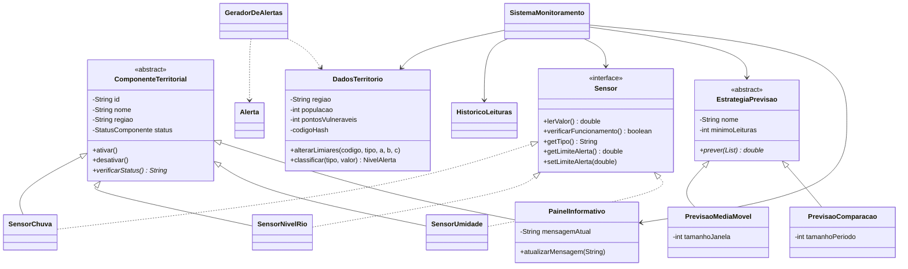

# Territory Predictive Insights (CitizenTech)

Global Solution 2º/2026 - Programação Orientada a Objetos (FIAP)

Integrantes: Bryan de Almeida (RM568081), Julia Yamazaki (RM568438) e Roberto Flaquer (RM567348).

Sistema de monitoramento territorial em Java que lê sensores simulados, faz previsões simples e emite alertas explicados, para apoiar a decisão de quem cuida de um bairro.

**Recorte escolhido: clima local** (chuva intensa e risco de alagamento em pontos vulneráveis).

## Público beneficiado e decisão apoiada

- **Quem sofre o problema:** moradores de áreas sujeitas a alagamento (margens de córregos, baixadas, ruas sem drenagem adequada), principalmente famílias que perdem móveis, renda e segurança quando a água sobe sem aviso.
- **Quem usa o sistema:** a coordenação local (associação de bairro, defesa civil municipal ou cooperativa comunitária).
- **Decisão que o sistema apoia:** *"vale avisar os moradores, preparar abrigos e limpar galerias agora, ou ainda dá para só acompanhar?"*. O sistema mostra o que os sensores indicam para os próximos minutos e qual nível de alerta isso representa. A decisão continua sendo de uma pessoa.

O território é descrito apenas por **região e equipamentos**. Não há nenhum dado pessoal de pessoas reais.

## Como compilar e executar

Requisito: **Java 11 ou superior** (testado com Java 17).

Dentro da pasta do projeto:

```
javac *.java
java SistemaMonitoramento
```

Opcional, para repetir exatamente a mesma simulação (útil em testes e na apresentação):

```
java SistemaMonitoramento --seed 42
```

Notas:

- Todas as mensagens do console são escritas **sem acentos** de propósito, para não aparecerem caracteres quebrados no terminal do Windows.
- O **código de acesso padrão** para alterar limiares é `alagamento2026` (pode ser trocado no menu 3 → opção 6).
- O arquivo `historico_leituras.csv` é criado na pasta onde o programa roda (veja "Bônus").

### Roteiro rápido para ver tudo funcionando

1. Escolha **2**: o sistema **se cala** (sem leituras suficientes) e explica por quê.
2. Escolha **4**, informe `20` leituras e cenário `3` (tempestade chegando): o sistema simula, prevê e emite os alertas sozinho.
3. Leia a explicação de cada alerta (qual sensor, valor previsto, limite estourado, cálculo usado e sugestão).
4. Escolha **3 → 5** e tente mudar um limiar com código errado, com valores fora de ordem e com o código certo.
5. Escolha **3 → 3** e tente uma população negativa: a alteração é rejeitada e o valor anterior é mantido.
6. Escolha **6** para desativar um sensor e rode **2** de novo: o sensor inativo fica sem previsão.

## Menu do sistema

| Opção | O que faz |
|---|---|
| 1 | Verifica os sensores: faz uma nova leitura de cada um e diz se passou do limite de alerta |
| 2 | Roda as duas previsões em cada sensor e emite os alertas (com explicação) |
| 3 | Gerencia dados do território (região, população, pontos vulneráveis, limiares com código, troca de código) |
| 4 | Simula as próximas N leituras em um cenário (normal, chuva moderada, tempestade) e já avalia os alertas |
| 5 | Exibe o status completo: dados, componentes, últimas leituras, estratégias, alertas e painel |
| 6 | Ativa ou desativa um componente |
| 7 | Limpa o histórico de leituras |
| 0 | Sai (salvando o histórico) |

## Estrutura e conceitos de POO

```
ComponenteTerritorial.java   classe abstrata (id, nome, região, status; ativar/desativar; verificarStatus() abstrato)
Sensor.java                  interface (lerValor, verificarFuncionamento, getTipo, limites...)
SensorChuva.java             extends ComponenteTerritorial implements Sensor
SensorNivelRio.java          extends ComponenteTerritorial implements Sensor
SensorUmidade.java           extends ComponenteTerritorial implements Sensor
PainelInformativo.java       extends ComponenteTerritorial (exibe a mensagem de orientação)
DadosTerritorio.java         encapsulamento (tudo privado, validação, código de acesso protegido)
EstrategiaPrevisao.java      classe abstrata das previsões
PrevisaoMediaMovel.java      extends EstrategiaPrevisao (janela de N leituras)
PrevisaoComparacao.java      extends EstrategiaPrevisao (período atual x anterior)
Alerta.java, NivelAlerta.java, GeradorDeAlertas.java   alertas com nível e explicação
HistoricoLeituras.java       guarda as leituras em ArrayList e salva/recarrega em arquivo
StatusComponente.java, Formato.java                    apoio
SistemaMonitoramento.java    classe principal com o menu e o loop
```

### Onde está cada conceito

- **Classe abstrata:** `ComponenteTerritorial` não pode ser instanciada; define `ativar()` e `desativar()` (concretos) e `verificarStatus()` (abstrato). `SensorChuva`, `SensorNivelRio`, `SensorUmidade` e `PainelInformativo` herdam dela com `extends`.
- **Interface:** `Sensor` define o contrato (`lerValor`, `verificarFuncionamento`, `getTipo`, limites). Três classes a implementam com `implements`, cada uma com sua dinâmica (a chuva "esfria" rápido, o rio reage devagar, o solo seca devagar).
- **Encapsulamento:** em `DadosTerritorio` todos os atributos são `private`. Os setters validam antes de gravar e lançam exceção com mensagem clara, então o valor anterior nunca é perdido. O código de acesso é guardado só como hash SHA-256 com sal, não tem getter, e após 3 erros o acesso é bloqueado por 30 s.
- **Herança:** `EstrategiaPrevisao` concentra o que é comum (nome, mínimo de leituras, média de um trecho, regra de leituras suficientes). Cada filha chama `super(...)` no construtor, usa `super.exigirLeiturasSuficientes(...)` e `super.descreverMetodo()`, tem atributos próprios e sobrescreve `prever()`.
- **Polimorfismo:** o sistema guarda uma `List<EstrategiaPrevisao>` e uma `List<Sensor>` e trata todos do mesmo jeito, sem saber o tipo concreto.

### Diagrama de classes



## Como funcionam as previsões e os alertas

Cada leitura é guardada em um `ArrayList` por sensor. As duas estratégias rodam sobre esse histórico:

| Estratégia | Atributo próprio | Mínimo de leituras | Cálculo |
|---|---|---|---|
| Média Móvel | `tamanhoJanela` (5) | 5 | média das últimas 5 leituras |
| Comparação de Períodos | `tamanhoPeriodo` (3) | 6 | média das últimas 3 leituras contra as 3 anteriores; a mesma variação é projetada para o próximo período (nunca abaixo de zero) |

O valor previsto é comparado com os limiares do tipo de sensor (um valor que **atinge ou passa** o limiar entra naquele nível):

| Sensor | Unidade | ATENÇÃO | ALERTA | CRÍTICO |
|---|---|---|---|---|
| Chuva | mm/h | 25 | 50 | 75 |
| Nível do rio | m | 2,5 | 3,5 | 4,5 |
| Umidade do solo | % | 70 | 85 | 95 |

Cada alerta informa o **sensor**, o **valor previsto**, o **limite estourado**, o **método e o cálculo** usados, o contexto (população e pontos vulneráveis) e uma sugestão de ação. Os limiares e valores acima são **suposições didáticas** da equipe, não valores oficiais de defesa civil; em uso real, deveriam ser definidos com os órgãos competentes.

Se um sensor está inativo, ou se há menos leituras que o mínimo, o sistema **não prevê** e explica o motivo.

## Bônus: histórico em arquivo

As leituras são salvas em `historico_leituras.csv` (uma por linha, `idDoSensor;valor`) ao simular, ao limpar e ao sair, e **recarregadas ao iniciar**. Linhas inválidas (formato errado, sensor desconhecido, valor fora da faixa física do sensor) são ignoradas com aviso. Apague o arquivo (ou use a opção 7) para começar do zero.

## Reflexão crítica

**Quando o sistema deve se calar?** Previsão com poucos dados engana. Por isso a média móvel exige 5 leituras e a comparação de períodos exige 6 (dois períodos de 3). Abaixo disso o sistema não mostra número nenhum e diz quantas leituras faltam. Também se cala quando o sensor está inativo, porque leituras antigas de um sensor parado não descrevem o presente. Um alerta falso gera desconfiança, e a comunidade passa a ignorar os alertas verdadeiros. Calar por falta de base é melhor do que falar com uma certeza que o sistema não tem.

**O que os dados não representam?** Um pluviômetro, um sensor de rio e um de solo para um bairro inteiro dizem pouco sobre uma rua específica: pode chover forte a dois quilômetros do sensor, e um ponto de alagamento pode ter entupimento que nenhum sensor enxerga. Os valores aqui são simulados, as previsões são médias simples que ficam "atrasadas" quando a chuva sobe rápido, e os limiares são suposições. O sistema também não sabe quem precisa de ajuda: idosos, pessoas com mobilidade reduzida e famílias sem acesso a celular não aparecem em nenhum número.

**Por que o alerta apoia a decisão em vez de decidir?** Quem conhece o território sabe o que o sensor não sabe: o bueiro que já entupiu, a obra na esquina, a rota de fuga que está bloqueada. Evacuar um bairro tem custo e risco reais, e essa responsabilidade precisa ficar com uma pessoa que possa explicar a escolha. Por isso cada alerta mostra o raciocínio (sensor, valor, limite, cálculo) para ser conferido, traz sugestões em vez de ordens ("avaliar acionar a Defesa Civil") e termina lembrando que a decisão é da coordenação local. O código de acesso nos limiares também faz parte disso: só quem é responsável pode mudar o que conta como "perigo".

## Limitações conhecidas

- Os sensores são simulados com valores aleatórios em faixas realistas; não há hardware real.
- Os limiares alterados no menu valem só durante a execução (o que é salvo em arquivo é o histórico de leituras).
- O código de acesso é digitado no console e aparece na tela (um terminal comum não esconde a digitação de forma portável). Em um sistema real, viria de um mecanismo de autenticação.
- Previsões simples (média e comparação), como pede o desafio; não substituem modelos meteorológicos.

## Como continuaríamos

Ler dados reais de uma fonte pública (por exemplo, séries do INMET) no lugar da simulação, salvar os limiares em arquivo, adicionar uma simulação de 24 horas com alertas ao longo do tempo e testes automatizados com JUnit.

## Decisões da equipe

- Recorte **clima local**, porque os três sensores (chuva, rio, solo) se complementam: solo encharcado e rio alto tornam a mesma chuva mais perigosa.
- Os sensores também herdam de `ComponenteTerritorial`, pois são equipamentos instalados no território e compartilham id, nome, região e status.
- Os limiares ficam em `DadosTerritorio` (protegidos por código) e o limite de alerta de cada sensor acompanha o limiar ALERTA, para haver uma só fonte de verdade.
- Alterações inválidas lançam exceção **antes** de gravar, garantindo que o valor anterior seja mantido.
- Mensagens sem acentos no console, para funcionar em qualquer terminal.

## Uso de IA

A ideia inicial e a primeira versão da estrutura do código (classes, relações e menu) foram desenvolvidas com apoio de uma ferramenta de IA, a partir do enunciado. Depois disso, a equipe revisou o código, executou o sistema e adaptou partes ao longo do projeto.